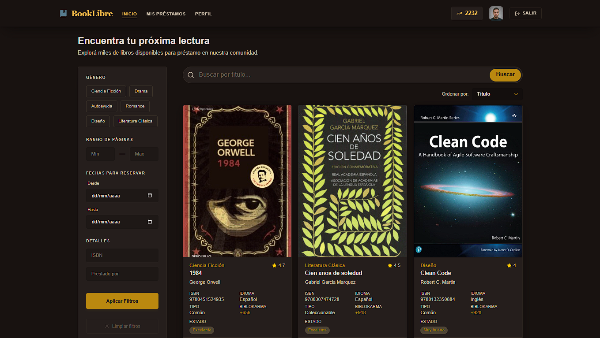
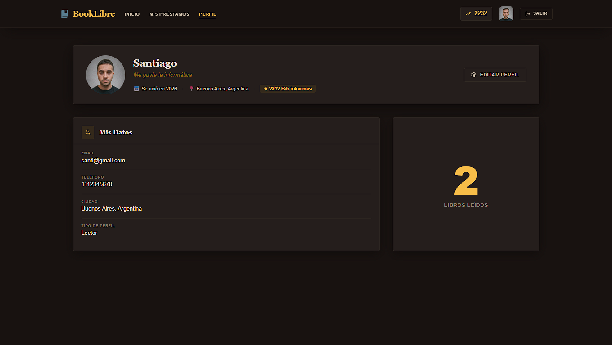
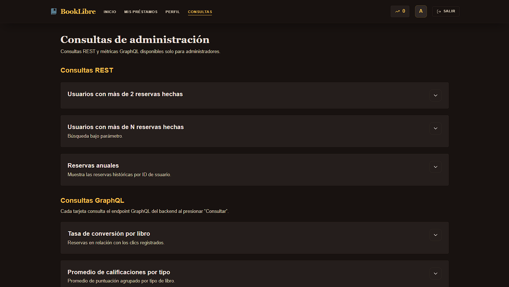

# BookLibre — Frontend

BookLibre is a community book-lending application. Members can browse books shared by other people, reserve an available book for a selected period, and offer books from their own collection. The goal is to encourage reading and make it easier for a community to share books.

This repository contains the web interface, built with React, TypeScript, and Vite. It communicates with the BookLibre API for authentication, catalogue browsing, reservations, profiles, and administrative queries.

The API and backend implementation are maintained in the [BookLibre backend repository](https://github.com/SRodriguezSpina/booklibre-backend/tree/feat/ajustes-deploy).

## How it works

Members can use BookLibre as a **Reader**, a **Publisher**, or both. Readers discover and reserve books; Publishers manage the books they offer. Reader & Publisher accounts combine both sets of features.

Reservations have a start and end date. The interface estimates the Bibliokarmas associated with a reservation. Bibliokarmas are part of the app's exchange mechanics; they are not a cash payment.

## Main sections

### Home — `/home`

Home is the community book catalogue. Members can:

- Search by title.
- Filter by genre, page range, intended loan dates, ISBN, and publisher.
- Sort results by title, author, or publisher.
- Browse paginated results and open a book's detail page.

The detail page shows the book's information, availability, ratings, and publisher. Eligible members can choose a loan period and confirm a reservation when the book is available.



### My Loans — `/mis-prestamos`

This section shows the loans associated with the signed-in member. Available tabs depend on the account type:

- **Lent to me:** books the member has reserved from others.
- **Lent by me:** the member's books reserved by other people; available to Publisher and Reader & Publisher accounts.

Members can search by title or author and review each loan's dates, status, and Bibliokarmas. After a received loan has been returned, the reader can rate the book and leave a comment.


### My Profile — `/perfil`

The profile displays personal information and Bibliokarmas. Members can edit their name, description, email, phone number, location, profile type, and profile image.

Readers can see their books-read statistic. Publisher and Reader & Publisher accounts also get a collection manager to add, edit, and remove books, check availability, and review click activity. Publisher accounts can also see their most-viewed book and click history.




### Admin consultations

The administration page is available only to accounts with the admin role. It brings together REST reports and GraphQL metrics:

- REST reports for members with returned loans, members above a configurable reservation count, and a member's annual reservations.
- GraphQL book conversion rates, average ratings by book type, catalogue health, the top five Bibliokarma scores, and a recent activity feed of added books and confirmed reservations.

The results are loaded on demand from the backend. The backend also enforces admin authorization; hiding the page in the frontend is not the only access control.



## Run locally

The frontend requires the BookLibre API to be running at `http://localhost:8080/api`. Start the backend and its dependencies separately, then run this repository.

### With Docker Compose

```powershell
docker compose up --build
```

The frontend will be available at [http://localhost:5173](http://localhost:5173).

### With Node.js

```powershell
npm ci
npm run dev
```

For a different API URL, copy `.env.example` to `.env.local` and set `VITE_API_URL`. Vite reads this variable when starting the development server or building the app.

## Tech stack

- React and TypeScript
- Vite
- Tailwind CSS
- React Router
- Axios
- Vitest and Testing Library
